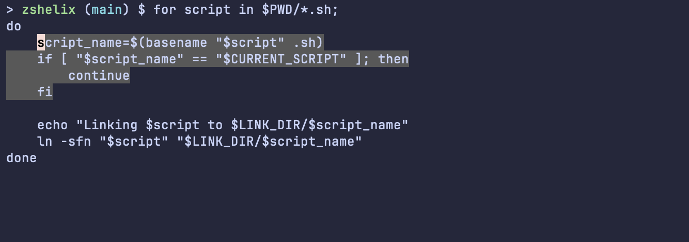

# zshelix

Helix keybindings for zsh. zshelix ports Helix's editing model to the zsh command line, rather than mapping Helix keys onto zsh's vi mode, so commands behave the way they do in Helix: selections come first, there can be several of them, and motions, text objects, search, registers, macros and undo all follow Helix's rules.



Highlights:

- Normal, insert and select modes, with counts, and the `g`, `m`, `[`, `]`, `space` and `z` menus (with a popup listing the keys, like Helix's).
- Multiple selections: `s`, `S`, `K`, `C`, `Alt-s`, `,`, `(`, `)`, `&`, `_` and friends, with typing, deleting and pasting applied at every selection.
- Word, paragraph and pair text objects (`mi`, `ma`), surround (`ms`, `mr`, `md`) and bracket matching (`mm`).
- Regex search with `/`, `?`, `n`, `N` and `*`, with live previews.
- Registers, including the system clipboard (`space y`, `space p`, `"+`), plus macros (`Q`, `q`) and repeating the last insert (`.`).
- Helix's undo tree (`u`, `U`, `Alt-u`, `Alt-U`) and jumplist (`Ctrl-o`, `Tab`).
- Shell pipes (`|`, `!`, `Alt-!`, `$`) and a `:` command line with `:sort`, `:pipe`, `:yank-join` and more.

Expected behaviour is taken from Helix itself: the test suite runs every case in Helix and in zsh and compares the results (see [Tests](#tests)).


## Installation

zshelix needs zsh 5.3 or later, built with PCRE support (the `zsh/pcre` module) for the regex commands. Most distributions and Homebrew build zsh with PCRE.

### Manually

1. Clone this repository (replace `$HOME/zshelix` with a different directory if preferred):
   ```sh
   git clone https://github.com/thomasschafer/zshelix.git $HOME/zshelix
   ```

1. Source `zshelix.plugin.zsh` in your `.zshrc` file:
   ```sh
   source $HOME/zshelix/zshelix.plugin.zsh
   ```

### With a plugin manager

- [antidote](https://github.com/mattmc3/antidote): add `thomasschafer/zshelix` to your `.zsh_plugins.txt`.
- [zinit](https://github.com/zdharma-continuum/zinit): `zinit light thomasschafer/zshelix`
- [zplug](https://github.com/zplug/zplug): `zplug "thomasschafer/zshelix"`
- [sheldon](https://github.com/rossmacarthur/sheldon): `sheldon add zshelix --github thomasschafer/zshelix`
- [Oh My Zsh](https://ohmyz.sh): clone the repository into `$ZSH_CUSTOM/plugins/zshelix` and add `zshelix` to `plugins`.

### Other plugins

Load zshelix before plugins that wrap zle widgets, such as [zsh-syntax-highlighting](https://github.com/zsh-users/zsh-syntax-highlighting) and [zsh-autosuggestions](https://github.com/zsh-users/zsh-autosuggestions). Bindings that other plugins (fzf, atuin and so on) add to the `viins` keymap are kept, since zshelix uses `viins` for insert mode.

zshelix makes `viins` the main keymap, so plain `bindkey KEY WIDGET` calls made earlier in your `.zshrc` (which bind in the emacs keymap) no longer apply. Bind with `bindkey -M viins`, or after sourcing zshelix.

zshelix uses `add-zle-hook-widget` for its `zle-line-init`, `zle-line-pre-redraw` and `zle-line-finish` hooks. Snippets that define those widgets directly with `zle -N zle-line-init ...` replace zshelix's hooks, so convert them to `add-zle-hook-widget` too.

To accept autosuggestions with the arrow and End keys in insert mode, add zshelix's widgets to the accept list:

```sh
ZSH_AUTOSUGGEST_ACCEPT_WIDGETS+=(zhm_move_char_right zhm_goto_line_end_newline)
```


## Differences from Helix

A command line isn't a file, so a few things work differently:

- Enter runs the command line in normal, select and insert mode. Use `Ctrl-j` to insert a newline.
- Tab completes in insert mode, `Ctrl-r` searches history, `Ctrl-l` clears the screen, `Ctrl-p` and `Ctrl-n` move through history, and `Ctrl-d` on an empty line exits the shell. In normal mode, `Ctrl-d` otherwise moves down half a page as in Helix, and in insert mode deletes the next character.
- Moving up from the first line (`k` or Up) or down from the last line goes to the previous or next history entry, keeping the cursor's column. At the ends of the history the cursor stays put. Set `ZHM_HISTORY_NAVIGATION=0` to turn this off.
- The text starts out as if it ended with a newline, as files usually do, so the cursor can sit after the last character (`gl`, `x` and `A` all behave as they do on the last line of a file).
- `:w`, `:x` and `:wq` run the command line, and `:q` abandons it.
- Without tree-sitter there's no syntax awareness: indentation, bracket matching (`mm`) and the closest-pair text objects use Helix's plain-text behaviour, which is what Helix does in a file with no language. Indentation defaults to two spaces (Helix's setting for shell scripts), and is detected from the text when there is some.
- Features that need files, buffers, windows, language servers, tree-sitter or a debugger aren't available: pickers, `gd` and other goto-definition commands, `=`, `Alt-o` and the other syntax tree commands, `]f` and the other syntax-based text objects and motions, diagnostics, `Ctrl-w` window commands and scrolling the view.
- `Ctrl-s` (commit undo checkpoint in insert mode) needs flow control turned off with `unsetopt flow_control`, otherwise the terminal intercepts it.
- `Ctrl-c` and `Ctrl-z` are handled by the terminal (interrupt and suspend), so `Ctrl-c` doesn't toggle comments; use `space c`.
- Shell commands (`|`, `!` and so on) run with `sh -c`, as in Helix. Set `ZHM_SHELL` to use something else.
- Keys handled by widgets that aren't part of zshelix (Tab completion, fzf, atuin and so on) aren't recorded in macros or repeated by `.`, since zshelix only sees their effect on the text.


## Configuration

Set these before sourcing zshelix.

| Variable | Default | Description |
| --- | --- | --- |
| `ZHM_INITIAL_MODE` | `insert` | Mode for each new command line: `insert` or `normal`. |
| `ZHM_CURSOR_NORMAL` | `$ZHM_CURSOR_BLOCK` | Escape sequence to set the cursor in normal mode. |
| `ZHM_CURSOR_INSERT` | `$ZHM_CURSOR_BEAM` | Escape sequence to set the cursor in insert mode. |
| `ZHM_CURSOR_SELECT` | `$ZHM_CURSOR_BAR` | Escape sequence to set the cursor in select mode. |
| `ZHM_STYLE_SELECTION` | `bg=238` | Highlight for selections (in zsh's `region_highlight` format). |
| `ZHM_STYLE_PRIMARY_SELECTION` | `bg=240` | Highlight for the primary selection. |
| `ZHM_STYLE_CURSOR` | `bg=250,fg=black` | Highlight for the cursors of selections other than the primary one. |
| `ZHM_DEFAULT_YANK_REGISTER` | `"` | Register used by `y`, `p`, `d` and `c` when none is selected. `ZSH_HELIX_SYSTEM_CLIPBOARD=1` sets this to `+`, the system clipboard. |
| `ZHM_CLIPBOARD_PROVIDER` | detected | One of `pasteboard`, `wayland`, `xclip`, `xsel`, `win32yank`, `tmux` or `termcode` (OSC 52, copy only). |
| `ZHM_CLIPBOARD_COPY`, `ZHM_CLIPBOARD_PASTE` | unset | Commands (as arrays) to copy from standard input and paste to standard output, for a clipboard tool zshelix doesn't know about. Both must be set. |
| `ZHM_INDENT_WIDTH` | `2` | Spaces per indent, or `0` for tabs. |
| `ZHM_TAB_WIDTH` | `8` | Width of a tab, for vertical movement and indentation. |
| `ZHM_AUTO_PAIRS` | `1` | Insert closing brackets and quotes automatically. |
| `ZHM_SEARCH_WRAP_AROUND` | `1` | Searches wrap around the end of the text. |
| `ZHM_HISTORY_NAVIGATION` | `1` | Move through history from the first and last lines. |
| `ZHM_HISTORY_PREV_WIDGET` | `up-history` | Widget used to go to the previous history entry (for example `up-line-or-beginning-search`). |
| `ZHM_HISTORY_NEXT_WIDGET` | `down-history` | Widget used to go to the next history entry. |
| `ZHM_ACCEPT_LINE_WIDGET` | `accept-line` | Widget used to run the command line. |
| `ZHM_JUMP_LABEL_ALPHABET` | `abcdefghijklmnopqrstuvwxyz` | Characters used for `gw` jump labels. |
| `ZHM_STYLE_JUMP_LABEL` | `fg=red,bold` | Highlight for `gw` jump labels. |
| `ZHM_COMMENT_TOKEN` | `#` | Token used by the comment commands. |
| `ZHM_SHELL` | `(sh -c)` | Command (as an array) used to run shell commands. |
| `ZHM_KEYTIMEOUT` | `1` | Value for zsh's `KEYTIMEOUT`, in hundredths of a second. A short timeout makes Escape responsive. |

For example, for a block cursor in every mode with a different colour for each:

```sh
ZHM_CURSOR_NORMAL=$'\e[2 q\e]12;#b8c0e0\a'
ZHM_CURSOR_INSERT=$'\e[2 q\e]12;#f4dbd6\a'
ZHM_CURSOR_SELECT=$'\e[2 q\e]12;#f5a97f\a'
```

`$ZHM_CURSOR_BLOCK`, `$ZHM_CURSOR_BEAM` and `$ZHM_CURSOR_BAR` can be used as values for block, beam and bar cursors.

The current mode is available as `$ZHM_MODE` (`normal`, `insert` or `select`), for example to show it in a prompt. If a function called `zhm_mode_changed` exists, it's called with the old and new modes whenever the mode changes.

### Keybindings

After sourcing zshelix, bindings can be changed with `zhm_bind`, which takes a mode, keys in Helix's notation and a command name:

```sh
zhm_bind normal 'C-e' goto_line_end
zhm_bind insert 'C-a' goto_line_start
zhm_bind normal 'g a' select_all  # within an existing menu
```

`zhm_unbind` removes a binding, e.g. `zhm_unbind normal 'C-a'`.

Every command is also a zle widget called `zhm_<command>`, so `bindkey` works too, e.g. `bindkey -M viins '^E' zhm_goto_line_end_newline`. The keymaps are `zhm-normal`, `zhm-select` and `viins`.


## Keybindings

### Normal mode

| Key | Description | Command |
| --- | --- | --- |
| `h`, `Left` | Move left | `move_char_left` |
| `j`, `Down` | Move down | `move_visual_line_down` |
| `k`, `Up` | Move up | `move_visual_line_up` |
| `l`, `Right` | Move right | `move_char_right` |
| `t` | Move till next occurrence of char | `find_till_char` |
| `f` | Move to next occurrence of char | `find_next_char` |
| `T` | Move till previous occurrence of char | `till_prev_char` |
| `F` | Move to previous occurrence of char | `find_prev_char` |
| `r` | Replace with new char | `replace` |
| `R` | Replace with yanked text | `replace_with_yanked` |
| `Alt-.` | Repeat last motion | `repeat_last_motion` |
| `~` | Switch (toggle) case | `switch_case` |
| `` ` `` | Switch to lowercase | `switch_to_lowercase` |
| `` Alt-` `` | Switch to uppercase | `switch_to_uppercase` |
| `Home` | Goto line start | `goto_line_start` |
| `End` | Goto line end | `goto_line_end` |
| `w` | Move to start of next word | `move_next_word_start` |
| `b` | Move to start of previous word | `move_prev_word_start` |
| `e` | Move to end of next word | `move_next_word_end` |
| `W` | Move to start of next long word | `move_next_long_word_start` |
| `B` | Move to start of previous long word | `move_prev_long_word_start` |
| `E` | Move to end of next long word | `move_next_long_word_end` |
| `v` | Enter selection extend mode | `select_mode` |
| `G` | Goto line | `goto_line` |
| `:` | Enter command mode | `command_mode` |
| `i` | Insert before selection | `insert_mode` |
| `I` | Insert at start of line | `insert_at_line_start` |
| `a` | Append after selection | `append_mode` |
| `A` | Insert at end of line | `insert_at_line_end` |
| `o` | Open new line below selection | `open_below` |
| `O` | Open new line above selection | `open_above` |
| `d` | Delete selection | `delete_selection` |
| `Alt-d` | Delete selection without yanking | `delete_selection_noyank` |
| `c` | Change selection | `change_selection` |
| `Alt-c` | Change selection without yanking | `change_selection_noyank` |
| `C` | Copy selection on next line | `copy_selection_on_next_line` |
| `Alt-C` | Copy selection on previous line | `copy_selection_on_prev_line` |
| `s` | Select all regex matches inside selections | `select_regex` |
| `Alt-s` | Split selection on newlines | `split_selection_on_newline` |
| `Alt--` | Merge selections | `merge_selections` |
| `Alt-_` | Merge consecutive selections | `merge_consecutive_selections` |
| `S` | Split selections on regex matches | `split_selection` |
| `;` | Collapse selection into single cursor | `collapse_selection` |
| `Alt-;` | Flip selection cursor and anchor | `flip_selections` |
| `%` | Select whole document | `select_all` |
| `x` | Select current line, if already selected, extend to next line | `extend_line_below` |
| `X` | Extend selection to line bounds | `extend_to_line_bounds` |
| `Alt-x` | Shrink selection to line bounds | `shrink_to_line_bounds` |
| `/` | Search for regex pattern | `search` |
| `?` | Reverse search for regex pattern | `rsearch` |
| `n` | Select next search match | `search_next` |
| `N` | Select previous search match | `search_prev` |
| `*` | Use current selection as the search pattern, automatically wrapping with `\b` on word boundaries | `search_selection_detect_word_boundaries` |
| `Alt-*` | Use current selection as search pattern | `search_selection` |
| `u` | Undo change | `undo` |
| `U` | Redo change | `redo` |
| `Alt-u` | Move backward in history | `earlier` |
| `Alt-U` | Move forward in history | `later` |
| `y` | Yank selection | `yank` |
| `p` | Paste after selection | `paste_after` |
| `P` | Paste before selection | `paste_before` |
| `Q` | Record macro | `record_macro` |
| `q` | Replay macro | `replay_macro` |
| `>` | Indent selection | `indent` |
| `<` | Unindent selection | `unindent` |
| `J` | Join lines inside selection | `join_selections` |
| `Alt-J` | Join lines inside selection and select spaces | `join_selections_space` |
| `K` | Keep selections matching regex | `keep_selections` |
| `Alt-K` | Remove selections matching regex | `remove_selections` |
| `,` | Keep primary selection | `keep_primary_selection` |
| `Alt-,` | Remove primary selection | `remove_primary_selection` |
| `&` | Align selections in column | `align_selections` |
| `_` | Trim whitespace from selections | `trim_selections` |
| `(` | Rotate selections backward | `rotate_selections_backward` |
| `)` | Rotate selections forward | `rotate_selections_forward` |
| `Alt-(` | Rotate selections contents backward | `rotate_selection_contents_backward` |
| `Alt-)` | Rotate selection contents forward | `rotate_selection_contents_forward` |
| `Alt-:` | Ensure all selections face forward | `ensure_selections_forward` |
| `Esc` | Enter normal mode | `normal_mode` |
| `Ctrl-b`, `PageUp` | Move page up | `page_up` |
| `Ctrl-f`, `PageDown` | Move page down | `page_down` |
| `Ctrl-u` | Move page and cursor half up | `page_cursor_half_up` |
| `Ctrl-d` | Move page and cursor half down (exit the shell if the line is empty) | `eof_or_page_cursor_half_down` |
| `Ctrl-i`, `Tab` | Jump forward on jumplist | `jump_forward` |
| `Ctrl-o` | Jump backward on jumplist | `jump_backward` |
| `Ctrl-s` | Save current selection to jumplist | `save_selection` |
| `"` | Select register | `select_register` |
| `\|` | Pipe selections through shell command | `shell_pipe` |
| `Alt-\|` | Pipe selections into shell command ignoring output | `shell_pipe_to` |
| `!` | Insert shell command output before selections | `shell_insert_output` |
| `Alt-!` | Append shell command output after selections | `shell_append_output` |
| `$` | Filter selections with shell predicate | `shell_keep_pipe` |
| `Ctrl-a` | Increment item under cursor | `increment` |
| `Ctrl-x` | Decrement item under cursor | `decrement` |
| `.` | Repeat the last insert | `repeat_last_insert` |
| `Enter` | Run the command line | `accept_line` |
| `Ctrl-l` | Clear the screen | `clear_screen` |
| `Ctrl-p` | Previous history entry | `history_prev` |
| `Ctrl-n` | Next history entry | `history_next` |
| `g` | Goto menu (see below) | |
| `m` | Match menu (see below) | |
| `[` | Left bracket menu (see below) | |
| `]` | Right bracket menu (see below) | |
| `Space` | Space menu (see below) | |
| `z` | View menu (see below) | |

#### Goto (`g`)

| Key | Description | Command |
| --- | --- | --- |
| `g` | Goto line number `<n>` else file start | `goto_file_start` |
| `\|` | Goto column | `goto_column` |
| `e` | Goto last line | `goto_last_line` |
| `h` | Goto line start | `goto_line_start` |
| `l` | Goto line end | `goto_line_end` |
| `s` | Goto first non-blank in line | `goto_first_nonwhitespace` |
| `t` | Goto window top | `goto_window_top` |
| `c` | Goto window center | `goto_window_center` |
| `b` | Goto window bottom | `goto_window_bottom` |
| `k` | Move up | `move_line_up` |
| `j` | Move down | `move_line_down` |
| `.` | Goto last modification | `goto_last_modification` |
| `w` | Jump to a two-character label | `goto_word` |

#### Match (`m`)

| Key | Description | Command |
| --- | --- | --- |
| `m` | Goto matching bracket | `match_brackets` |
| `s` | Surround add | `surround_add` |
| `r` | Surround replace | `surround_replace` |
| `d` | Surround delete | `surround_delete` |
| `i` | Match inside menu (see below) | |
| `a` | Match around menu (see below) | |

#### Match inside (`m` then `i`)

Any other character: select inside surrounding pair (`select_textobject_inside_surrounding_pair`).

| Key | Description | Command |
| --- | --- | --- |
| `w` | Select inside word | `select_textobject_inside_word` |
| `W` | Select inside WORD | `select_textobject_inside_WORD` |
| `p` | Select inside paragraph | `select_textobject_inside_paragraph` |
| `m` | Select inside closest surrounding pair | `select_textobject_inside_closest_surrounding_pair` |

#### Match around (`m` then `a`)

Any other character: select around surrounding pair (`select_textobject_around_surrounding_pair`).

| Key | Description | Command |
| --- | --- | --- |
| `w` | Select around word | `select_textobject_around_word` |
| `W` | Select around WORD | `select_textobject_around_WORD` |
| `p` | Select around paragraph | `select_textobject_around_paragraph` |
| `m` | Select around closest surrounding pair | `select_textobject_around_closest_surrounding_pair` |

#### Left bracket (`[`)

Any other character: select inside previous pair (`select_textobject_inside_prev_pair`).

| Key | Description | Command |
| --- | --- | --- |
| `p` | Goto previous paragraph | `goto_prev_paragraph` |
| `Space` | Add newline above | `add_newline_above` |

#### Right bracket (`]`)

Any other character: select inside next pair (`select_textobject_inside_next_pair`).

| Key | Description | Command |
| --- | --- | --- |
| `p` | Goto next paragraph | `goto_next_paragraph` |
| `Space` | Add newline below | `add_newline_below` |

#### Space (`Space`)

| Key | Description | Command |
| --- | --- | --- |
| `y` | Yank selections to clipboard | `yank_to_clipboard` |
| `Y` | Yank main selection to clipboard | `yank_main_selection_to_clipboard` |
| `p` | Paste clipboard after selections | `paste_clipboard_after` |
| `P` | Paste clipboard before selections | `paste_clipboard_before` |
| `R` | Replace selections by clipboard content | `replace_selections_with_clipboard` |
| `c` | Comment/uncomment selections | `toggle_comments` |
| `C` | Block comment/uncomment selections | `toggle_block_comments` |
| `Alt-c` | Line comment/uncomment selections | `toggle_line_comments` |

#### View (`z`)

| Key | Description | Command |
| --- | --- | --- |
| `Ctrl-b`, `PageUp` | Move page up | `page_up` |
| `Ctrl-f`, `PageDown` | Move page down | `page_down` |
| `Ctrl-u`, `Backspace` | Move page and cursor half up | `page_cursor_half_up` |
| `Ctrl-d`, `Space` | Move page and cursor half down | `page_cursor_half_down` |
| `/` | Search for regex pattern | `search` |
| `?` | Reverse search for regex pattern | `rsearch` |
| `n` | Select next search match | `search_next` |
| `N` | Select previous search match | `search_prev` |

### Select mode

Select mode has all of the normal mode bindings, except for these, which extend the selection rather than replacing it.

| Key | Description | Command |
| --- | --- | --- |
| `h`, `Left` | Extend left | `extend_char_left` |
| `j`, `Down` | Extend down | `extend_visual_line_down` |
| `k`, `Up` | Extend up | `extend_visual_line_up` |
| `l`, `Right` | Extend right | `extend_char_right` |
| `w` | Extend to start of next word | `extend_next_word_start` |
| `b` | Extend to start of previous word | `extend_prev_word_start` |
| `e` | Extend to end of next word | `extend_next_word_end` |
| `W` | Extend to start of next long word | `extend_next_long_word_start` |
| `B` | Extend to start of previous long word | `extend_prev_long_word_start` |
| `E` | Extend to end of next long word | `extend_next_long_word_end` |
| `n` | Add next search match to selection | `extend_search_next` |
| `N` | Add previous search match to selection | `extend_search_prev` |
| `t` | Extend till next occurrence of char | `extend_till_char` |
| `f` | Extend to next occurrence of char | `extend_next_char` |
| `T` | Extend till previous occurrence of char | `extend_till_prev_char` |
| `F` | Extend to previous occurrence of char | `extend_prev_char` |
| `Home` | Extend to line start | `extend_to_line_start` |
| `End` | Extend to line end | `extend_to_line_end` |
| `Esc` | Exit selection mode | `exit_select_mode` |
| `v` | Enter normal mode | `normal_mode` |
| `g` | Goto menu (see below) | |

#### Goto (`g`)

| Key | Description | Command |
| --- | --- | --- |
| `g` | Extend to line number `<n>` else file start | `extend_to_file_start` |
| `\|` | Extend to column | `extend_to_column` |
| `e` | Extend to last line | `extend_to_last_line` |
| `k` | Extend up | `extend_line_up` |
| `j` | Extend down | `extend_line_down` |
| `w` | Extend to a two-character label | `extend_to_word` |

### Insert mode

Any other key is inserted as text, as in Helix (so unbound Ctrl and Alt keys insert their letter). Keys with a meaning in the shell, such as Tab for completion and Ctrl-r for history search, keep their shell behaviour.

| Key | Description | Command |
| --- | --- | --- |
| `Esc` | Enter normal mode | `normal_mode` |
| `Ctrl-s` | Commit changes to new checkpoint | `commit_undo_checkpoint` |
| `Ctrl-w`, `Alt-Backspace` | Delete previous word | `delete_word_backward` |
| `Alt-d`, `Alt-Delete` | Delete next word | `delete_word_forward` |
| `Ctrl-u` | Delete till start of line | `kill_to_line_start` |
| `Ctrl-k` | Delete till end of line | `kill_to_line_end` |
| `Ctrl-h`, `Backspace` | Delete previous char | `delete_char_backward` |
| `Ctrl-d` | Delete next char (exit the shell if the line is empty) | `eof_or_delete_char_forward` |
| `Delete` | Delete next char | `delete_char_forward` |
| `Ctrl-j` | Insert newline char | `insert_newline` |
| `Shift-Tab` | Insert tab char | `insert_tab` |
| `Up` | Move up | `move_visual_line_up` |
| `Down` | Move down | `move_visual_line_down` |
| `Left` | Move left | `move_char_left` |
| `Right` | Move right | `move_char_right` |
| `PageUp` | Move page up | `page_up` |
| `PageDown` | Move page down | `page_down` |
| `Home` | Goto line start | `goto_line_start` |
| `End` | Goto newline at line end | `goto_line_end_newline` |
| `Enter` | Run the command line | `accept_line` |
| `Ctrl-l` | Clear the screen | `clear_screen` |
| `Ctrl-p` | Previous history entry | `history_prev` |
| `Ctrl-n` | Next history entry | `history_next` |


## Tests

The tests in `tests/` are differential: each case gives a starting text and keys, and the result (the text, every selection with its direction, the primary selection and the mode) is compared against Helix's result for the same keys. Helix's results are recorded in `tests/expected.json`, so running the tests only needs zsh and Python:

```sh
tests/run.py
```

With Helix installed, `tests/run.py --record` records results for new cases, and `tests/fuzz.py` runs random key sequences in both Helix and zsh and minimises any differences it finds.

`tests/visual.py` checks what's actually drawn: it renders zsh's output with a terminal emulator ([pyte](https://github.com/selectel/pyte)) and, after each command in random key sequences, checks that the screen shows the text, selection highlights, cursor and message zshelix expects, with nothing left over. `--plugins DIR` runs it with zsh-syntax-highlighting and zsh-autosuggestions loaded from `DIR`.


## Similar projects

[zsh-helix-mode](https://github.com/Multirious/zsh-helix-mode) also provides Helix keybindings for zsh.
